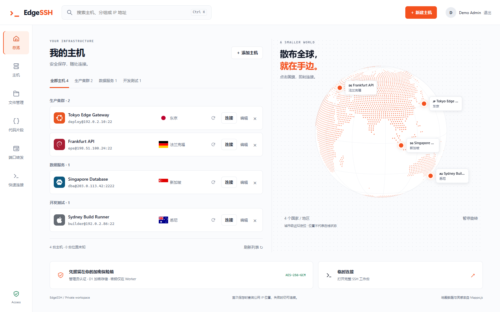
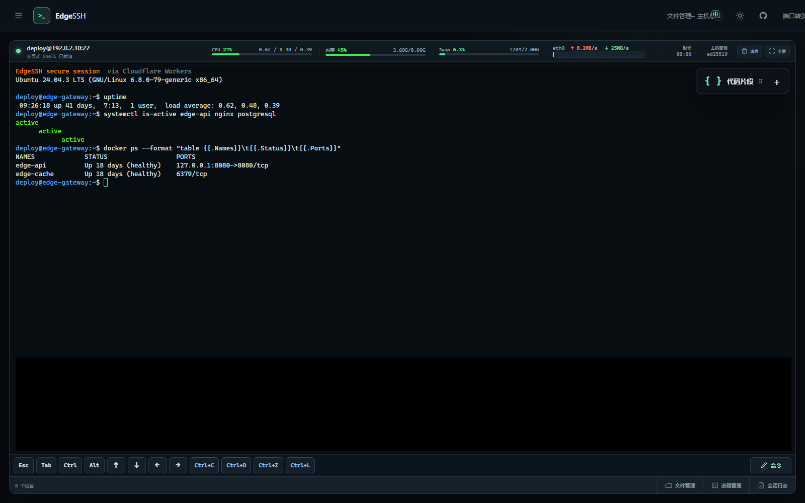
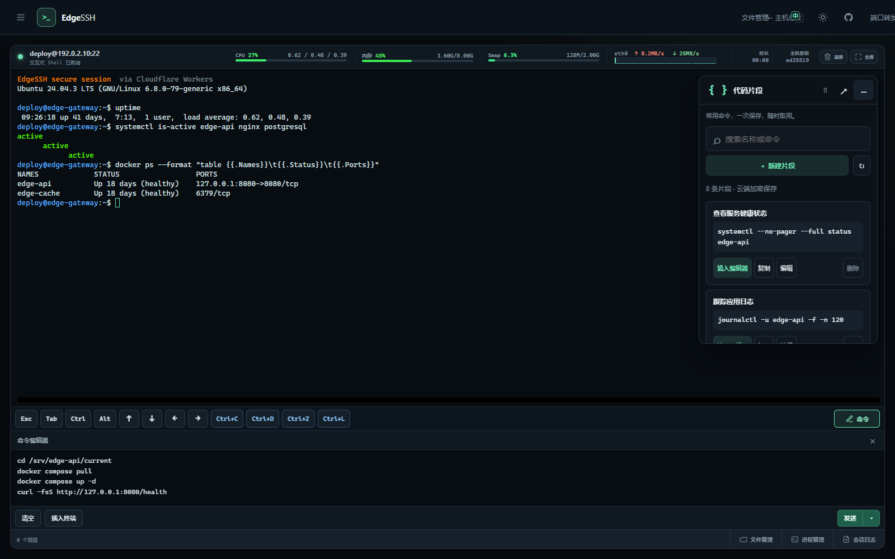
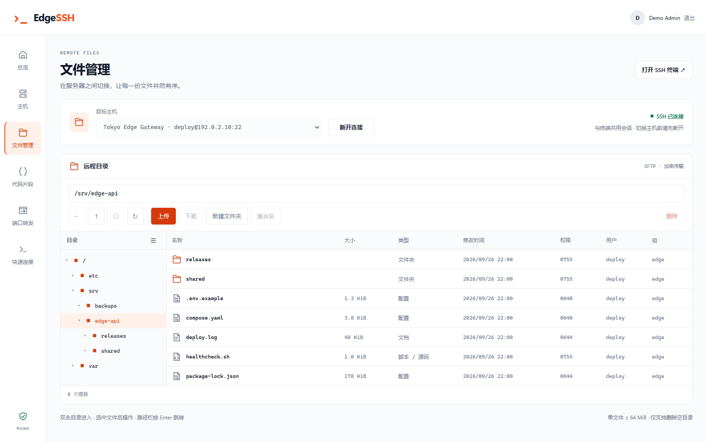
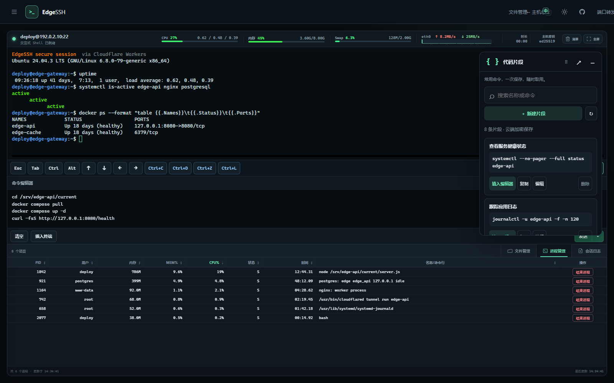
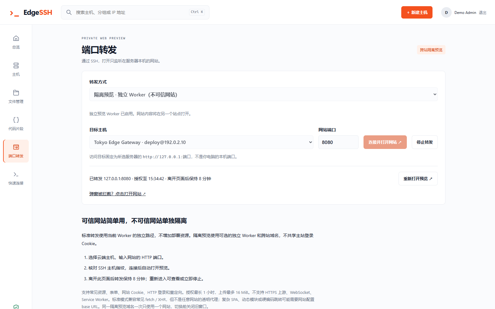
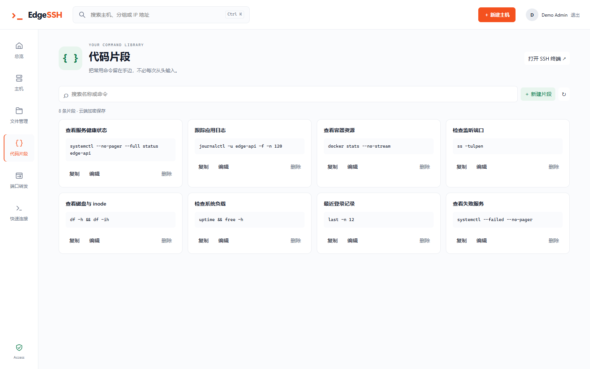
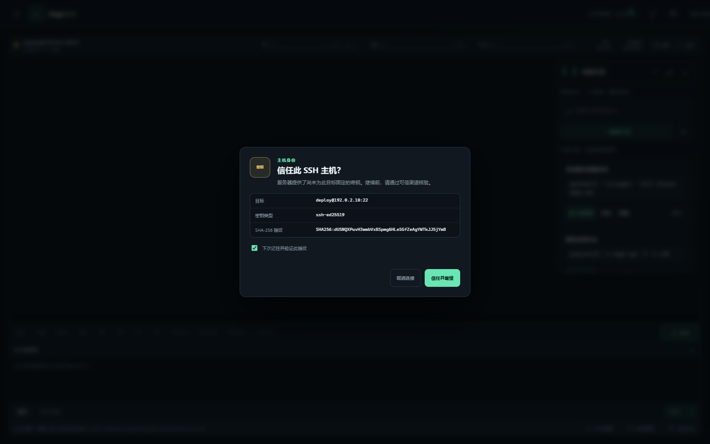

<div align="center">

# EdgeSSH · 开源 WebSSH 工作台

<p><strong>浏览器里的 SSH 终端与 SFTP 文件管理，运行在你自己的 Cloudflare 上。</strong></p>

把主机管理、在线终端、文件传输、进程监控与远程 HTTP 服务预览，收进一个个人服务器管理工作台，无需额外维护 SSH 中转服务器。

<p><sub>An open-source, self-hosted WebSSH client on Cloudflare Workers — browser-based SSH terminal, SFTP file manager, and server monitoring.</sub></p>

**Cloudflare-native · Self-hosted · Single-admin · Open source**

<br />

<p>
  <a href="https://workers.cloudflare.com/"></a>
  <a href="https://www.typescriptlang.org/"></a>
  <a href="LICENSE"></a>
  <a href="https://edgessh-docs.pages.dev/"></a>
</p>

<br />

<p>
  <strong><a href="https://edgessh-docs.pages.dev/deploy/actions">快速部署</a></strong> ·
  <a href="#功能特性">功能特性</a> ·
  <a href="#安全设计">安全设计</a> ·
  <a href="#本地开发">本地开发</a> ·
  <a href="https://edgessh-docs.pages.dev/">文档站 →</a>
</p>

<br />



<sub>全部演示数据使用文档保留地址与虚构信息，不对应任何真实服务器。</sub>

<br />

**你的服务器 · 你的凭据 · 你的 Cloudflare · 你的 SSH 工作台**

</div>

<details>
<summary><strong>快速导航 · 功能、部署与技术说明</strong></summary>

- **了解产品**：[为什么是 EdgeSSH](#为什么是-edgessh) · [功能特性](#功能特性) · [当前支持](#当前支持)
- **开始使用**：[快速部署](#快速部署) · [认证方式](#认证) · [完整部署指南](https://edgessh-docs.pages.dev/deploy/actions)
- **了解边界**：[安全设计](#安全设计) · [信任边界](#信任边界) · [端口转发安全](#端口转发安全)
- **参与开发**：[本地开发](#本地开发) · [项目结构](#项目结构) · [Contributing](#contributing)

</details>

---

## CLI / Agent 调用

本地 Agent 可以通过 CLI 使用现有主机、SSH 和文件功能，使用 Cloudflare Access 浏览器登录并复用令牌。需要先部署本次代码并安装 Node.js 22.12+ 与 cloudflared。

```sh
npm --prefix cli ci
npm install --global ./cli
edgessh login --url https://ssh.example.com
edgessh hosts
edgessh exec "主机名" --json -- 'uname -a'
edgessh get "主机名" /var/log/app.log ./app.log
```

支持交互终端、目录查看、上传下载、创建目录、重命名和删除。命令执行与文件操作按需连接，完成即断开，设有超时和输出上限。安装、指纹确认、Agent 用法和资源消耗说明见 [CLI 文档](cli/README.md)。

## 为什么是 EdgeSSH？

SSH 客户端不少，WebSSH 也算不上新鲜。

EdgeSSH 想解决的是另一件事：

> **能不能不再维护一套 SSH 中转服务器，却依然拥有一个随时能从浏览器打开的个人 SSH 工作台？**

EdgeSSH 把 WebSSH 的连接层、主机管理与工作台界面，一起部署在 Cloudflare 上。

浏览器只负责交互；应用逻辑与认证交给 Cloudflare Worker；每一个 SSH 会话都由独立的 Durable Object 承载，再通过 Cloudflare TCP Sockets 连到你的服务器。

<table>
<tr>

<td width="25%" valign="top">

### ☁️ Cloudflare Native

跑在 Cloudflare Workers 上。

不用再单独维护一台 WebSSH 中转 VPS。

</td>

<td width="25%" valign="top">

### 🧰 SSH Workspace

不只是一个 Terminal。

主机、文件、进程、代码片段和远程服务，都在同一个工作台里。

</td>

<td width="25%" valign="top">

### 🔐 Self-hosted

部署在你自己的 Cloudflare 账户里。

数据库、Worker 和配置，全部由你掌控。

</td>

<td width="25%" valign="top">

### 👤 Single Admin

面向个人服务器管理场景。

没有多租户、没有成员系统，也没有复杂的权限模型。

</td>

</tr>
</table>

<div align="center">

**它不只是塞进浏览器里的一个 Terminal。**

<p><strong>它是部署在 Cloudflare 上的个人 SSH 工作台。</strong></p>

</div>

---

## 功能特性

### 一个地方，管好你所有的服务器

EdgeSSH 把散落各处的服务器连接信息，收进统一的主机库。

在这里你可以：

- 保存、编辑服务器信息
- 搜索与整理主机
- 记录系统类型与服务器所在地
- 从 Dashboard 直接跳进 SSH
- 用密码、上传的 SSH 私钥或密钥链中的已有密钥认证
- 在不同设备间访问同一份工作区

主机资料与连接凭据会先用 **AES-256-GCM** 加密，再写入 D1。

### 密钥链

- 直接粘贴或上传未设口令的 OpenSSH Ed25519 / RSA / ECDSA 私钥；也可点击「生成」将 Ed25519 公私钥填入输入框，确认后保存
- 公钥可填写并校验，也可从私钥自动提取；支持复制公钥和按需下载私钥
- 私钥加密保存在 D1，列表不返回私钥；主机只保存密钥引用，连接时由 Worker 解密
- 同一密钥可用于多台主机，以及终端、文件管理和端口转发；仍被主机引用时不可删除

下载的私钥文件未设口令，请妥善保管。密钥链不会自动把公钥安装到目标服务器。

---

### 🖥️ SSH 在线终端 · Terminal

**打开浏览器，就是进了服务器。**



基于 xterm.js 的交互式终端，支持：

- SSH 2.0
- PTY
- 窗口尺寸同步
- Keepalive
- 全屏终端
- UTF-8 / GB18030 / Big5
- 密码认证
- keyboard-interactive
- OpenSSH 私钥认证



第一次连接某台服务器时，EdgeSSH 会先展示它的 **SHA-256 Host Key Fingerprint**。

只有你确认无误后，才会继续发送 SSH 凭据。

---

### 📁 SFTP 文件管理 · File Manager

**不必为了改一个文件,再多开一个工具。**



EdgeSSH 内置了一个基于 SFTP 的文件管理器：

- 浏览服务器目录
- 上传与下载
- 新建文件夹
- 重命名
- 删除文件
- 键盘导航
- 文件类型图标
- 在线编辑文本文件（代码高亮、Markdown 预览、自动保存）
- 从文件管理器直接跳回 SSH Terminal

选中 js/ts/css/html/json/md 等文本文件即可在弹窗里编辑：CodeMirror 6 与语言包按需加载，Markdown 预览依赖仅在预览时加载。
小文件停止输入 3 秒后自动保存，自动写入至少间隔 10 秒；达到 128K 字符时改为 15 秒防抖、30 秒最小间隔。
Ctrl/Cmd+S 和关闭前的保存不受此间隔限制。保存仍传输整个文件，但不会为每次自动保存重新读取整个目录。
文本按扩展名白名单 + 单文件 2 MiB 限制，读取使用现有 SFTP 连接的 64 KiB 二进制分块，超限与二进制文件仍走下载。
保存前和 rename 前都核对远端 mtime；未能取得新版本时暂停自动保存，不会静默跳过检查后覆盖。
mtime 仅为秒级尽力检测，并非文件锁或原子比较写入，请避免多人同时编辑同一文件。
文件管理器按主机记住上次目录（只存在浏览器本地）。

Terminal 与 File Manager 共用同一个 SSH 会话，切换之间不必重新连接。

---

### 📊 服务器进程监控 · Server Monitor



在 SSH 会话里就能直接看到：

**CPU · Load · Memory · Swap · Processes · OS · Architecture**

不需要跳出工作台,也不需要在服务器上额外装一个 Agent。

---

### 🔌 HTTP 端口转发 · Port Forwarding

服务器上有些服务只监听：

```text
127.0.0.1:3000
```

在 EdgeSSH 里,同样可以打开它。



EdgeSSH 能借助已有的 SSH 会话,访问服务器本地的 HTTP 服务,并在浏览器里给出一个临时预览。

适合这些场景:

**开发服务器 · 本地 Dashboard · 管理面板 · 调试接口**

如果要打开的是一个不太信任的网页,可以改用独立的 Preview Worker,把预览页面和 EdgeSSH 管理界面隔离开来。

> Port Forwarding 不是一个通用反向代理。WebSocket、HTTPS 上游以及部分复杂 Web 应用,目前还有一些限制。

[查看端口转发与安全说明 →](#端口转发安全)

---

### 📝 命令片段库 · Code Snippets



把常用命令存下来:

```bash
docker ps
df -h
free -h
journalctl -xe
```

需要的时候:

**搜索 → 填入 Terminal → 检查一遍 → 执行**

代码片段通过 D1 同步,而不是只存在某一个浏览器里。

---

### 🌍 服务器,也可以从地球上看

EdgeSSH 会根据服务器的公网 IP,估算出大致地理位置,并画在 Dashboard 的地球上。

点一下主机,就能从地图直接跳进对应的服务器。

地球组件用的是轻量的 Canvas 球面投影,没有引入 Three.js 这类较重的 3D Runtime。

> 地理位置仅用于可视化展示,不代表服务器的实时在线状态。

---

## 一套工作台,多种服务器管理方式

```text
                         EdgeSSH
                            │
        ┌───────────────────┼───────────────────┐
        │                   │                   │
      Hosts              Workspace           Tools
        │                   │                   │
    Credentials          Terminal          File Manager
      Groups              SFTP             Monitoring
    Locations           Sessions           Snippets
        │                   │             Port Forward
        └───────────────────┼───────────────────┘
                            │
                       Your Servers
```

不管你手上是:

**VPS · Cloud VM · NAS · Home Server · Development Machine**

只要它能通过公网 SSH 访问,就可以加入 EdgeSSH。

---

## Cloudflare-native

EdgeSSH 不需要你另外部署一套 WebSSH Backend。

```text
Browser
│
│ HTTPS / WebSocket
▼
Cloudflare Worker
│
├── Authentication
├── Host Management
├── Encrypted Storage ──────→ D1
├── Static App / API
│
└── Session Ticket
        │
        ▼
Durable Object
│
│ Cloudflare TCP Socket
▼
SSH Server
```

SSH 握手、认证、密钥交换以及 Channel 通信,都在 Worker 一侧完成。

浏览器实际连接的是你的 EdgeSSH Worker,而不是直接跟目标服务器建立 TCP 连接。

### 用到的 Cloudflare 能力

**Workers**

跑起 EdgeSSH 的应用、API 与 SSH 协议逻辑。

**Durable Objects**

给每个 SSH 会话一份独立的生命周期与 WebSocket 状态。

**D1**

存放加密后的主机资料、管理员信息和代码片段。

**TCP Sockets**

从 Cloudflare 网络出发,建立到 SSH Server 的 TCP 连接。

---

## 认证

EdgeSSH 是一个 **Single-admin Workspace**。

它不是 SaaS 多租户系统,没有成员、组织,也没有角色权限。

目前支持两种登录方式:

<table>
<tr>

<td width="50%" valign="top">

### GitHub OAuth

适合想快速部署的用户。

用指定的 GitHub 账号,作为唯一的管理员身份。

**不需要 Cloudflare Zero Trust。**

</td>

<td width="50%" valign="top">

### Cloudflare Access

适合已经在用 Cloudflare Zero Trust 的用户。

可以用邮箱 OTP,也可以接入已有的 Identity Provider。

</td>

</tr>
</table>

两种方式二选一即可。

切换认证 Provider 不会新建一个用户工作区,也不会重新生成一份主机资料库。

---

## 安全设计

服务器管理工具天生要经手高权限凭据,所以 EdgeSSH 一直在尽量收窄默认的攻击面。

### 加密存储

主机密码、私钥以及相关敏感资料,都会用 **AES-256-GCM** 加密后再存进 D1。

浏览器不会长期保存 SSH 凭据。

### Host Key Verification

第一次连接服务器,必须确认 SSH Host Key Fingerprint。

指纹一旦发生变化,会再次要求你确认。



### Single-admin

EdgeSSH 不开放注册,也没有多租户的数据隔离逻辑。

整个实例只属于一个管理员工作区。

### Session Isolation

每个 SSH 会话都由 Durable Object 单独管理。

会话入口使用临时票据,辅助连接也会做身份检查。

### SSRF Protection

连接目标必须解析到允许访问的公网地址,并且会在建立连接前检查解析结果。

---

### 信任边界

EdgeSSH **不是一个端到端加密的 SSH Gateway**。

Worker 本身就是真正的 SSH Client,建立连接时必然要处理 SSH 凭据和会话数据。

所以:

> **请只把 EdgeSSH 部署在你自己信任、自己掌控的 Cloudflare 账户里。**

同时建议给服务器上的 SSH 用户,配置刚好够用的最小权限。

---

## 快速部署

最推荐的方式是:

### 01 · Fork

把 EdgeSSH Fork 到你自己的 GitHub 账号下。

### 02 · 选择认证方式

GitHub OAuth:

```text
AUTH_PROVIDER=github          # Variable
GH_CLIENT_ID=<Client ID>      # Variable
GH_CLIENT_SECRET=<Secret>     # Secret
GH_ADMIN=<GitHub 用户名>      # Variable
```

首次部署请按 [GitHub OAuth 五步完整教程](DEPLOYMENT.md#github-模式准备)操作：创建的是 **OAuth App**，Client ID 放 Variable，Client Secret 放 Secret，回调必须是正式入口加 `/auth/callback`。无需 Zero Trust、Access 权限或额外 GitHub PAT。

**旧版点击登录报“服务暂时不可用”**：请同步含 2026-10-07 Base64 解码修复的代码，再对最新 `main` 运行 Deploy。保留原 Worker、D1 和 `ENCRYPTION_KEY`；不是靠扩大 Token 权限或换密钥解决。新版 Deploy 会自动检查 GitHub 登录入口与工作区状态。

或者 Cloudflare Access:

```text
AUTH_PROVIDER=cloudflare      # Variable,默认值
ADMIN_EMAIL=<管理员邮箱>       # Variable
```

从旧版升级时,请将 `GITHUB_CLIENT_ID`、`GITHUB_CLIENT_SECRET`、`GITHUB_ADMIN`、`GITHUB_ADMIN_ID`
分别迁移为 `GH_CLIENT_ID`、`GH_CLIENT_SECRET`、`GH_ADMIN`、`GH_ADMIN_ID`。GitHub 保留 `GITHUB_`
前缀,旧名称无法作为 Actions Variable 或 Secret 使用。

### 03 · 添加 Cloudflare Token

无论选择哪种认证方式,都要在 GitHub Actions Secrets 里加入 `CLOUDFLARE_API_TOKEN`。

### 04 · Run workflow

运行 `Deploy` Workflow。

剩下的交给 EdgeSSH 自动完成:

**Worker → Durable Object → D1 → Migration → Secrets → Deployment**

不用你手动去复制:

```text
D1 Database ID
Access AUD
Team Domain
Random Encryption Key
```

<div align="center">

### [查看完整部署指南 →](https://edgessh-docs.pages.dev/deploy/actions)

认证配置、API Token 权限、自定义域名、Preview Worker、升级与迁移,都在文档站里有详细说明。

</div>

---

## 当前支持

| 能力 | 支持情况 |
| --- | --- |
| SSH | SSH 2.0 / Shell / PTY / Resize / Keepalive |
| SFTP | SFTP v3 |
| Password | ✅ |
| keyboard-interactive | ✅ 单密码提示 |
| Ed25519 | ✅ |
| RSA | ✅ |
| ECDSA | ✅ P-256 / P-384 / P-521 |
| File Manager | ✅ |
| Process Monitor | ✅ |
| OS Detection | ✅ |
| Code Snippets | ✅ |
| HTTP Port Forward | ✅ |
| Multiple Admins | ❌ |
| SCP | ❌ |
| ProxyJump | ❌ |
| SSH Agent | ❌ |
| Encrypted Private Keys | 暂不支持 |

单一管理员工作区,最多可以保存 **200 台主机**。

SFTP 单文件上传和下载的上限是 **64 MiB**。

---

## 端口转发安全

EdgeSSH 的 Port Forward 提供两种模式。

### Trusted

直接走 EdgeSSH 主 Worker。

适用于:

> **你自己开发、自己部署、自己信得过的网页。**

这种模式和 EdgeSSH 管理界面共享浏览器 Origin,所以不建议用来打开不可信的站点。

### Isolated

通过独立的 Preview Worker 提供页面。

适用于:

> **没法完全信任的远程 Web 应用。**

Preview Worker 和 EdgeSSH 主界面运行在不同的 Origin 上,能减少被代理页面反过来调用管理 API 的风险。

完整的安全模型、生命周期、Cookie 处理和当前的代理兼容范围,请看:

**[EdgeSSH 文档站 →](https://edgessh-docs.pages.dev/)**

---

## 本地开发

Requirements:

```text
Node.js >= 22.12
npm
Cloudflare Wrangler
```

Clone:

```bash
git clone https://github.com/aozorae/EdgeSSH.git
cd EdgeSSH

npm ci
cp .env.example .dev.vars
npx wrangler d1 migrations apply DB --local
npm run dev
```

前端开发:

```bash
npm run dev:web
```

### 常用命令

| Command | Description |
| --- | --- |
| `npm run dev` | Build frontend and start local Worker |
| `npm run dev:web` | Start Vite frontend |
| `npm run build:web` | Build frontend |
| `npm run typecheck` | TypeScript check |
| `npm test` | Run tests |
| `npm run test:browser` | Browser regression tests |
| `npm run showcase` | Regenerate privacy-safe README screenshots with local Chrome |
| `npm run check` | Full validation |
| `npm run deploy` | Deploy to Cloudflare |

---

## 项目结构

```text
EdgeSSH/
├── .github/workflows/    GitHub Actions deployment
├── frontend/             Web workspace
├── src/
│   ├── accounts/         Authentication & encrypted storage
│   ├── backend/          Sessions, SFTP & system detection
│   ├── ssh/              SSH protocol implementation
│   └── worker.ts         Worker entry
├── migrations/           D1 migrations
├── tests/                Tests
├── DEPLOYMENT.md         Deployment documentation
└── wrangler.toml         Cloudflare configuration
```

---

## 上游项目

EdgeSSH 基于:

### [Worker Web SSH / CF-Workers-WebSSH](https://github.com/cmliu/CF-Workers-WebSSH)

持续开发而来。

在原有的 Cloudflare WebSSH 能力之上,EdgeSSH 又加上了:

**Host Management · Encrypted Storage · File Manager · Monitoring · GitHub OAuth · Port Forwarding · Code Snippets · Globe Visualization**

感谢原作者 **CM / cmliu** 打下的这份开源基础。

---

## 特别致谢

特别感谢 [Linux.do 社区](https://linux.do/) 对 EdgeSSH 推广的支持，让 EdgeSSH 有机会在社区内发帖分享与交流。

---

## Contributing

欢迎提交:

**Issues · Bug Reports · Pull Requests · Documentation Improvements**

提交代码前,请先跑一遍:

```bash
npm run check
```

涉及 SSH、SFTP 或 Port Forward 的改动,请用你自己拥有授权的服务器来测试。

提交 Issue 时,有一件事拜托一定注意:

> **请不要上传密码、SSH 私钥、Access Token,或是包含敏感信息的日志。**

---

## Acknowledgements

- [cmliu/CF-Workers-WebSSH](https://github.com/cmliu/CF-Workers-WebSSH) — EdgeSSH 的直接上游
- [huashengdun/webssh](https://github.com/huashengdun/webssh) — WebSSH 与前端 API 参考
- [newbietan/CloudSSH](https://github.com/newbietan/CloudSSH) — Cloudflare Workers SSH 实现参考
- [crazypeace/huashengdun-webssh](https://github.com/crazypeace/huashengdun-webssh) — WebSSH 二次开发参考

---

## License

EdgeSSH is licensed under the [Apache License 2.0](LICENSE).

使用、修改与分发时,请保留适用的许可证与版权声明。

---

<div align="center">

<p><strong>EdgeSSH · 你的个人 WebSSH 工作台</strong></p>

<p>SSH infrastructure doesn't need another server to manage it.</p>

**Your servers · Your credentials · Your Cloudflare · Your workspace**

<br />

**[Deploy EdgeSSH →](https://edgessh-docs.pages.dev/deploy/actions)** · [📚 完整文档](https://edgessh-docs.pages.dev/)

</div>
